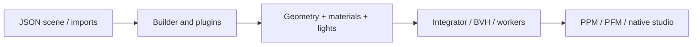

# Raytracer — Atelier

A remake and enhanced version of the original project I completed during my **second year at Epitech**. This version reworks the implementation and adds features beyond the original scope.

**Goal:** generate images from 3D scene descriptions by tracing camera rays, finding their intersections with objects, and computing lighting and shadows. The design uses C++ interfaces and design patterns to support new shapes, lights, and materials.

This implementation adds reflections and refraction, PBR path tracing, a native editor, and distributed rendering.


## What it renders

| Area | Included features |
|---|---|
| Geometry | Spheres, planes, infinite/finite cylinders and cones, triangles, boxes, torus, tanglecube, Mandelbulb, and Möbius surfaces |
| Scene construction | Translation, rotation, scaling, shear, nested groups, scene imports, and OBJ/MTL meshes |
| Materials | Solid colors, procedural/image textures, normal maps, mirrors, transparent surfaces, and rough PBR materials |
| Lighting | Ambient, directional, point, and area lights; soft shadows, indirect light, HDR environments, and photon caustics |
| Rendering tools | Antialiasing, BVH acceleration, multithreading, progressive previews, native editing, and TCP workers |

The required foundation renders configurable scenes to **PPM**, with basic shapes, transforms, lighting, shadows, and an adjustable camera. The advanced rendering methods and editor are extensions built around the same engine.

## Quick start

C++20, CMake ≥ 3.20, and Make for the engine; Python 3 for tests. SDL2 ≥ 2.0.17 and zlib for the studio; SFML 2.5/3 for the progressive viewer.

<details>
<summary>Install dependencies</summary>

```sh
# macOS
brew install cmake pkg-config sdl2-compat sfml zlib
# Debian / Ubuntu
sudo apt-get install build-essential cmake pkg-config libsdl2-dev libsfml-dev zlib1g-dev python3
```

</details>

```sh
make test
./raytracer --studio
./raytracer bonus/scenes/pbr_showcase.json
```

Run examples from the repository root. `render.output` is relative to the working directory; assets are relative to their scene. The output directory must exist.

## Choose a mode

| Mode | Purpose |
|---|---|
| `./raytracer scene.json` | Render to PPM or PFM |
| `--studio [scene.json]` | Native C++ SDL2/ImGui editing and progressive preview |
| `--gui --watch scene.json` | SFML viewer; R reloads, Escape cancels |
| `--preview scene.json` | Fast render with a reduced budget |
| `--worker PORT ROOT` / `--cluster host:port scene.json` | Distributed TCP rendering |

## Rendering approaches

The scene's `render.integrator` selects how light is transported:

| Integrator | Best suited to |
|---|---|
| `whitted` | Classic direct lighting, sharp reflections, and recursive refraction |
| `path` | Diffuse light bouncing between surfaces and color bleeding |
| `photon` | Caustics estimated from photons that pass through specular paths |
| `pbr` | Rough metals/glass, GGX materials, MIS sampling, absorption, and HDR lighting |

More samples reduce Monte Carlo noise at a higher CPU cost. Photon mapping uses a fixed-radius density estimate; finite depth and a fixed geometric epsilon also remain practical limits. [Models and trade-offs](doc/optics.md).

## Native studio

- **Edit the scene:** add or duplicate objects, assign materials, and adjust lights, camera, and environment settings.
- **See changes progressively:** edits cancel the previous worker and start a quick preview before the final quality pass.
- **Keep the result:** save a JSON scene, export the displayed PNG, or calculate linear HDR output as PFM.

The studio is a native **C++ SDL2/ImGui** application. The render worker runs separately from the interface, so scene editing can interrupt an ongoing calculation. [Controls and settings](doc/pbr-studio.md).

## How it works



Geometry, lights, materials, and integrators have separate interfaces. Factory/Builder assemble scenes; Decorator applies transformations; Composite represents groups and the BVH. Pixel-based random seeds keep results deterministic across thread counts and distributed workers.

## Documentation

| Topic | Guide |
|---|---|
| Interactive rendering | [Studio and PBR](doc/pbr-studio.md) |
| Scene authoring | [Scene format](doc/scene-format.md) |
| Algorithms and extensions | [Optics](doc/optics.md) · [Architecture](doc/architecture.md) |
| Subject coverage | [Features](doc/feature-matrix.md) · [Project defense](doc/defense.md) |
| Testing and measurement | [Validation](doc/validation.md) · [Profiling](doc/performance.md) · [Valgrind](doc/validation.md) |
| Distributed rendering | [Protocol](doc/network-protocol.md) |
| Binary downloads and packaging | [Releases](https://github.com/lelouchzr/raytracer/releases) · [Build a release](doc/releasing.md) |

`make BUILD=build-core BONUS=OFF test` checks the core; `make` restores bonus staging at the root. Types live in `.hpp`, methods in `.cpp`, compiled with `-Werror`. Errors: stderr and **84**; success: **0**.

License: [MIT](LICENSE) for the remake code; [third-party notices](THIRD_PARTY_NOTICES.md) remain applicable.
