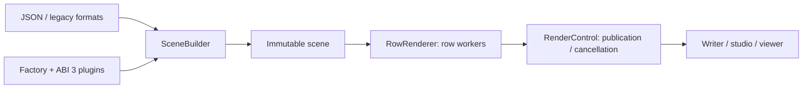

# Architecture and plugins

## Contracts

| Interface | Responsibility |
|---|---|
| `IPrimitive` | Nearest hit in `[lo,hi]`, conservative AABB |
| `Hit` | Local/world position, geometric/shading normals, UVs, tangents, boundary |
| `ILight` | Direction, radiance, distance, sampling/PDF, optional emission |
| `IMaterial` | Surface, textures, shading normal |
| `IIntegrator` | Linear radiance |
| `SceneBuilder` | Imports, paths, construction, validation |
| `RenderControl` | Synchronized rows, snapshots, cancellation |

Local rays are not renormalized, preserving `t`. Normals use the inverse transpose. Infinite objects stay outside bounded BVH subtrees.

## Patterns and files

| Pattern | Use | Sources |
|---|---|---|
| Factory | Shape/material/light creators | `scene/Factory` |
| Builder | Scene assembly/validation | `scene/SceneBuilder` |
| Decorator | Primitive transformations | `transform/` |
| Composite | Groups and BVH | `scene/`, `acceleration/` |

`include/rt/` contains types, `src/` methods, `bonus/include/rt/` and `bonus/src/` extensions. One class per header, corresponding implementation. SDL/ImGui stay on the main thread; workers read an immutable scene and are joined before replacement.

## Add a plugin

Complete example: `bonus/plugins/PluginSphere.hpp` and `.cpp`.

| C export | Contract |
|---|---|
| `raytracer_plugin_abi()` | Return **3** |
| `raytracer_register(Factory*)` | Register unique names |

`SharedLibrary` wraps `dlopen/dlsym/dlerror/dlclose`. Wrong ABI, missing symbol, or replacing a name is rejected. Failed registration rolls back; an already-loaded path is not registered twice.

Creators and `LeasePrimitive/Material/Light` retain the module. Objects are destroyed before their final module reference. GCC `-fno-gnu-unique` permits actual unloading; 64 cycles verified.

Engine/plugins require matching architecture/ABI and compatible compiler/stdlib. For a new shape, test interior, tangency, parallel rays, transformations, and BVH/linear comparison; undersized bounds could hide hits.
