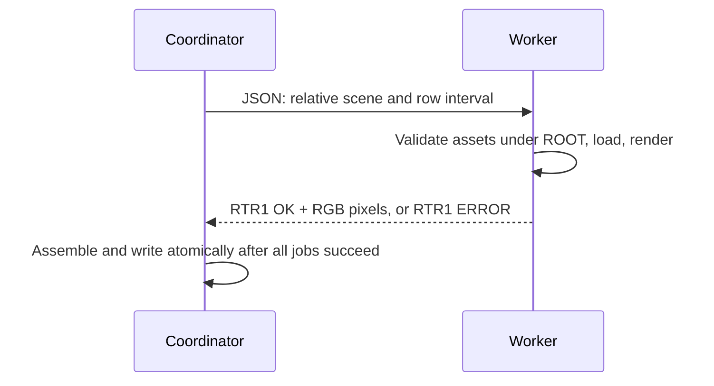

# Distributed rendering — RTR1

TCP IPv4, **16-row bands**, same seeds as local rendering. Machines need matching revisions/resources; assets are not transferred.

```sh
# On each worker
./raytracer --worker 9051 "$PWD" 0.0.0.0
# On the coordinator
./raytracer --cluster 192.168.1.20:9051,192.168.1.21:9051 bonus/scenes/gallery.json
```

`--worker PORT ROOT [BIND_IPV4]` defaults to `127.0.0.1`. Endpoints: numeric IPv4 or `localhost`. Rebuild plugins for each compatible architecture.



## Encoding

Control frames: big-endian uint32 length then payload, **≤1 MiB**. JSON request:

| Key | Value |
|---|---|
| `version` | Integer `1` |
| `scene` | Relative path under worker root |
| `begin`, `end` | Row interval `[begin,end)` |
| `width`, `height` | Image dimensions |
| `samples` | Maximum samples/pixel |

Response: `RTR1 OK WIDTH BEGIN END` or `RTR1 ERROR DIAGNOSTIC`. OK is followed by `width*(end-begin)` RGB triplets, big-endian IEEE-754 doubles after exposure/tone mapping, before gamma. Finite components ≥0, possibly >1 for HDR. A band is published only after complete receipt.

## Limits

| Element | Contract |
|---|---|
| Connection | Nonblocking, `poll`, 3 s timeout |
| Exchange | 30 s inactivity timeout; listener does not expire |
| Assets | Scenes/imports/OBJ/MTL/textures/plugins under canonical root, checked by role even with renamed extensions |
| Failure | Exit 84, previous image preserved |
| Trust | Trusted native plugins; no sandbox, encryption, authentication |
| Recovery | No automatic redistribution after losing a worker |
| Cost | Scene preparation per band; expensive photons can make local rendering faster |

`tests/systems.py` runs two actual workers and compares local/distributed images byte for byte, including PBR/HDR. It also checks versions, paths, renamed assets, unavailable endpoints, and errors. RAII BSD/POSIX sockets.
