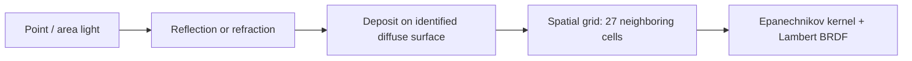

# Optics: choices and trade-offs

Linear-light pipeline: average → exposure → tone mapping → encoding. PBR defaults to sRGB, older modes to gamma2. PFM preserves linear radiance.

## Integrators

| `render.integrator` | Method | Use / limitation |
|---|---|---|
| `whitted` | Lambert/Phong, recursive reflection/refraction | Fast, artistic; approximate straight-line transparent shadows |
| `path` | Cosine-weighted diffuse bounces, next-event estimation, 0.8 Russian roulette after three bounces | Indirect light/color bleeding; no MIS in this classic mode |
| `photon` | Direct/specular plus photon map after specular chains | Caustics; biased fixed-radius density estimate |
| `pbr` | GGX BSDF, MIS, absorption, HDR | Physical mode; finite depth and residual noise |

[PBR settings and mathematical sources](pbr-studio.md).

## Lighting

| Element | Rule |
|---|---|
| Point | Inverse-square by default in path/photon; artistic attenuation available in Whitted |
| Area source | Finite parallelogram, uniform sampling; nonemitting back remains opaque |
| Classic path | NEE of registered lights; exclude their emission after diffuse continuation to avoid double counting |
| Ordinary emission | Reached through bounces, not automatically added to light registry |
| AO | Local ambient effect outside path, two-unit range |

Path/photon treat interfaces as blockers for direct shadows; refracted paths are transported separately.

## Photons

Flux normalized by emitted count: point `4πI`, area `πALe` per face. Lobe roulette preserves transmissive paths through partially diffuse glass. No specular chain means no caustic deposit. More photons and an adjusted radius improve the estimate; the mode remains a Phong/Whitted hybrid.

## Geometry and media

| Area | Convention / limitation |
|---|---|
| Boundaries | Stack by object identity, even with shared materials |
| Interior camera | Stack initialized through back-face hits, outside to inside |
| Volumes | Closed and nested; open surfaces/nonhierarchical overlaps lack this volume interpretation |
| Normals | Geometric for boundaries/offsets, interpolated/normal-mapped for shading |
| Torus / tanglecube | Quartics: derivatives, monotonic intervals, bisection, tangent roots |
| Mandelbulb / Möbius | Distance estimate / triangulated surface, adjustable approximations |
| Robustness | Fixed epsilon; use reasonable scene scales |

## Sampling

Classic AA: Latin hypercube. Adaptive: independent positions, Welford variance, stop in blocks of four after `minSamples`. Data-dependent stopping can be biased. Pixel-based seeds preserve determinism across workers.

[Formulas/NEE measurement](render-quality.md) · [Scene format](scene-format.md) · [Tests](validation.md).
