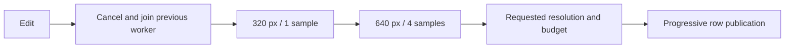

# Native studio and PBR rendering

**C++ SDL2 / Dear ImGui** application with a C++ rendering worker. Requires SDL2/zlib; ImGui and its license are bundled in `bonus/vendor/imgui`.

```sh
make
./raytracer --studio
./raytracer --studio gallery/06_product_studio.json
./raytracer --studio gallery/06_product_studio.json --frames 120 --screenshot studio.png
```

macOS application: `build/Atelier.app`. The headless engine remains available without graphics dependencies.

## Controls

| Area | Action |
|---|---|
| Tree / inspector | Add, duplicate, delete; referenced materials protected |
| Numbers | Click to type; drag to adjust; Enter to confirm |
| Camera | Drag: orbit; Shift+drag: pan; wheel: zoom |
| Rendering | Automatic, or explicitly render after edits; pause cancels work |
| Files | Open JSON/legacy scenes, save JSON, export PNG or HDR/PFM |
| Keyboard | F1..F4: scene/properties/render/files; Tab/Shift+Tab; Enter: edit; Space: button |
| Advanced JSON | Groups, matrices, fields not exposed in inspector |

Invalid scenes preserve the previous image. Saves/exports use temporary files and rename. Saved resource paths are absolute: adapt them when moving between machines.

Object transforms are explicit in the JSON: Position → `translate`, Rotation (degrees) → `rotate`, Scale → `scale`, Shear → `shear`. Identity values are added when opening older scenes. The advanced JSON editor includes the latest validated inspector edits. Rotating a uniformly colored sphere has no visible effect; try a box or a textured object instead.

[Example gallery](../gallery/README.md): seven selected scenes with JSON, PNG and PPM files. These are the scenes offered in the studio's Examples menu.



SDL/ImGui stay on the main thread. Final render time depends on scene/CPU.

## Physical settings

```json
{
  "environment": {"file": "../assets/studio.hdr", "intensity": 0.5, "rotation": 20},
  "render": {"integrator": "pbr", "samples": 128, "depth": 10, "toneMap": "neutral", "colorSpace": "srgb"}
}
```

| Material `type: pbr` | Range / effect |
|---|---|
| `color` | Albedo clamped to [0,1] |
| `roughness` | 0..1; <0.001: delta; otherwise `alpha=max(0.001,roughness²)` |
| `metallic`, `transmission` | 0..1; metal/glass lobes |
| `ior` | 1..3, dielectric index |
| `absorption` | RGB 0..1000; inverse scene units |

## Model and limitations

| Calculation | Method | Limitation |
|---|---|---|
| Microfacets | GGX/Smith, visible normals, reflection/transmission PDFs | Single scattering between microfacets |
| Fresnel | Unpolarized dielectric, Snell, TIR | Metals: RGB Schlick approximation |
| Transport | `beta *= f*abs(n·wi)/pdf`, Russian roulette | Finite depth, Monte Carlo noise |
| MIS | `p1²/(p1²+p2²)` for BSDF and area/HDR lights | Ordinary emissive geometry sampled by continuation |
| Media | Nested boundaries, `T(d)=exp(−absorption*d)` | Closed volumes, coherent hierarchy |
| Environment | Raw/RLE RGBE, luminance/solid-angle CDF, 0.1% uniform support | `-Y +X` orientation |
| Textures | Mipmaps, bilinear/trilinear, cone footprint | Approximation, no anisotropic EWA |
| Color | Decode sRGB textures; linear HDR/normal maps | Older modes retain `gamma2` |
| Output | Linear PFM, displayed PNG, `none/reinhard/neutral` | `neutral = RGB/(1+max(R,G,B))` |

References: [microfacets](https://www.pbr-book.org/4ed/Reflection_Models/Roughness_Using_Microfacet_Theory), [rough dielectrics](https://www.pbr-book.org/4ed/Reflection_Models/Rough_Dielectric_BSDF), [MIS](https://www.pbr-book.org/4ed/Light_Transport_I_Surface_Reflection/A_Better_Path_Tracer), [transmittance](https://www.pbr-book.org/4ed/Volume_Scattering/Transmittance), [environment](https://www.pbr-book.org/4ed/Light_Sources/Infinite_Area_Lights), [filtering](https://www.pbr-book.org/4ed/Textures_and_Materials/Image_Texture).

## Verification

Tests cover BSDF energy/PDFs, Fresnel/TIR, media, textures, resource relocation and actual native windows. A small diffuse scene can be compared with official PBRT using the [reference script](../bonus/reference/compare.py). See [testing commands](validation.md) for local checks. Raw session captures and machine-specific reports are not published.

Plugins use ABI **3** and must be rebuilt when that contract changes.
