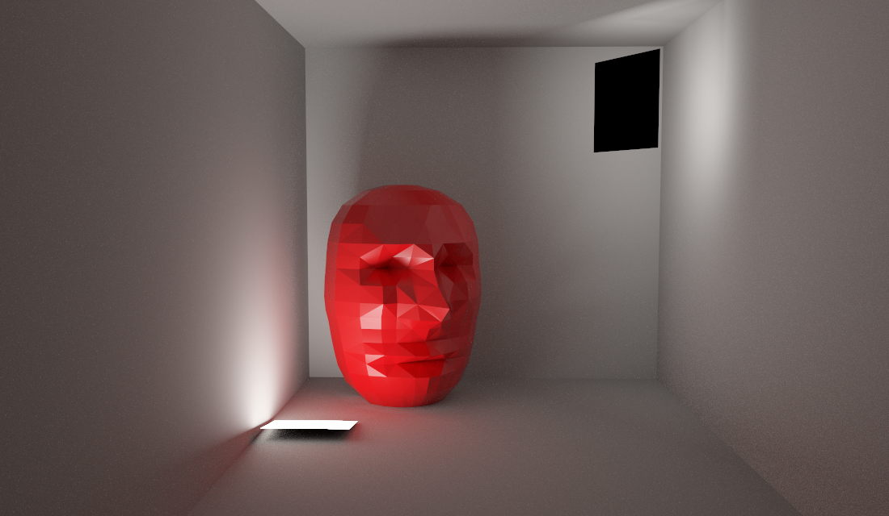

# Gallery

**Seven selected scenes. JSON, PNG and PPM files are together in this directory.** Pick a row below; its three files share the same name.

| Scene | Edit | View | RGB pixels |
|---|---|---|---|
| RGB cylinder lattice | [JSON](02_rgb_lattice.json) | [PNG](02_rgb_lattice.png) | [PPM](02_rgb_lattice.ppm) |
| Helices around a reflective column | [JSON](04_helix_column.json) | [PNG](04_helix_column.png) | [PPM](04_helix_column.ppm) |
| Finite primitive museum | [JSON](05_primitive_museum.json) | [PNG](05_primitive_museum.png) | [PPM](05_primitive_museum.ppm) |
| Glass, gold and ceramic product study | [JSON](06_product_studio.json) | [PNG](06_product_studio.png) | [PPM](06_product_studio.ppm) |
| Faceted red head and indirect illumination | [JSON](07_cornell_sculpture.json) | [PNG](07_cornell_sculpture.png) | [PPM](07_cornell_sculpture.ppm) |
| Cornell box, glass and color bleeding | [JSON](08_cornell_glass.json) | [PNG](08_cornell_glass.png) | [PPM](08_cornell_glass.ppm) |
| Textures, normal maps and rough metals | [JSON](09_texture_materials.json) | [PNG](09_texture_materials.png) | [PPM](09_texture_materials.ppm) |



## Open a scene

From the repository root:

```sh
./raytracer --studio gallery/07_cornell_sculpture.json
./raytracer gallery/07_cornell_sculpture.json
```

The second command calculates the PPM named in the JSON. Atelier's example menu lists these seven JSONs. Click a number to type, or drag to adjust; save keeps the current document. Position, rotation (degrees), scale and shear are explicit object fields.

## Red head

The original [OBJ sculpture](07_cornell_sculpture.obj) has **374 vertices and 744 flat-shaded triangles**. Brow ridges, recessed eye sockets, nose bridge/tip, cheeks, lips and jaw are modeled in the geometry. The closed mesh has consistent outward normals; its generator is [head.py](../tools/examples/head.py), under the project's MIT license.

The landscape room uses a tilted floor emitter and a second one-sided emitter aimed at the wall. Its black rear face remains visible to the camera while reflected light illuminates the room. The C++ PBR integrator calculates indirect bounces and the red color bleeding. This is an independent reconstruction inspired by the subject, not the original face model or a pixel-identical copy.

## Reproduce images

```sh
python3 tools/generate_examples.py
python3 tools/render_examples.py --select 07_cornell --threads 10
python3 tools/render_examples.py --profile preview --output /tmp/raytracer-previews
# Optional contact sheet; requires Pillow.
python3 tools/build_example_index.py
```

All published images are actual C++ renders. PNG and PPM preserve identical RGB pixels; no AI images, denoising or retouching. Physical scenes use 256–2,048 samples/pixel and can retain Monte Carlo grain. [Catalog](catalog.json) · [Overview](overview.png).

The museum and material studies reference `../bonus/assets/`; keep that resource layout when moving the gallery. Older technical JSONs in `bonus/scenes/` are retained for regression tests, outside the example menu.
